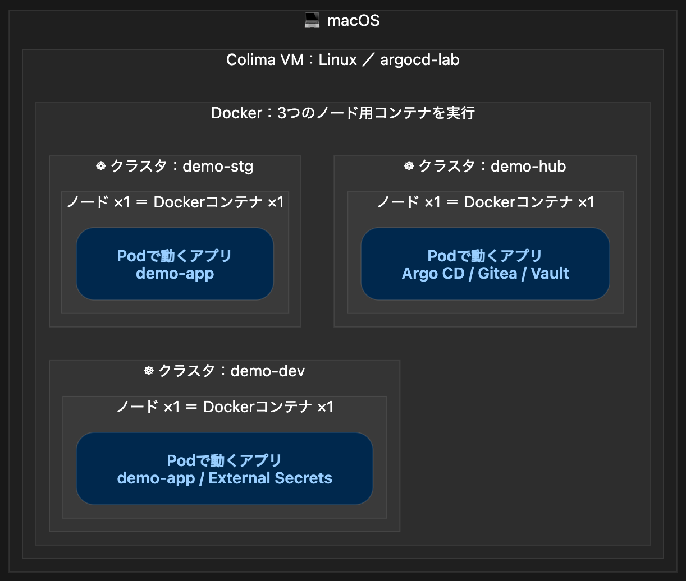

# Prerequisites: the layers of the tools involved

Before getting into Argo CD, get a grip on which layer each tool in this lab works at and what it does there.

| Layer | Role |
|---|---|
| Colima VM | Provides a Linux kernel. Containers run on Linux features, so macOS needs a VM |
| Docker | Runs containers inside the VM. The `docker` command on macOS sends its instructions here through a socket |
| Node | One docker container stands in for one Kubernetes node (kind). In this lab there is one per cluster, three in total |
| Apps running in Pods | Run inside each cluster. Argo CD, Gitea and Vault are on demo-hub, the demo app on demo-dev and demo-stg |

Only the CLIs and the browser are on the macOS side. Everything that runs is inside the VM.
Access to `localhost:8080` and the like goes through colima's port forwarding and kind's `extraPortMappings` to reach a NodePort on a node.

## lima / colima: providing Linux on macOS

Containers run on Linux kernel features (namespaces / cgroups), so they cannot run directly on macOS. A Linux VM is always needed somewhere.

- **lima**: a lightweight Linux VM manager for macOS. It takes care of creating VMs, file sharing and port forwarding
- **colima**: a wrapper that packages lima for docker / containerd / k8s use. A single `colima start` gives you a Linux VM + the docker daemon + the docker CLI configuration usable from the host. It is often used as a Docker Desktop replacement

## kind: K8s clusters out of docker containers

**K**ubernetes **in** **D**ocker. It builds a cluster by treating one docker container as one node.

- Starts fast (tens of seconds), several clusters can sit side by side, and deleting is instant. Good for testing and CI
- The clusters are on the same docker network, so they can reach each other by container name
  (the hub -> spoke and spoke -> Vault connections in this lab rely on this)
- Note that `kind create cluster` adds a context to `~/.kube/config` and switches current-context

## kubectl and contexts

kubectl decides which cluster to talk to by the **context** in the kubeconfig. This lab has three clusters, so
to prevent accidents every command states it explicitly, as in `--context kind-demo-dev`.

## helm: a template-based package manager

A distribution format for K8s manifests. **Values** (settings) are fed into a **chart** (a set of templates) to
generate (render) the manifests.

- Middleware is commonly distributed as charts (the official distribution of both Argo CD and ESO is a chart)
- `helm install` also does release management (history, rollback), but some setups use only the rendering (next section)

## kustomize: patch-based manifest composition

No templates. It composes manifests by **layering differences (overlays / patches) on plain YAML (a base)**. It is
built into kubectl (`kubectl kustomize`, `kubectl apply -k`).

- The standard layout is shared definitions in `base/` and per-environment differences in `overlay/dev/` and `overlay/stg/`
- The seed-repo of this lab (the demo app) uses this layout

**Where it meets helm**: kustomize has a `helmCharts` feature, and with `--enable-helm` it can take
"the result of rendering a chart with values" as input for kustomize.
Argo CD itself in this lab (`hub/argocd/`) works this way. It combines the distribution strength of charts with the
composition strength of kustomize, and does not use helm's release management (kubectl's server-side apply does the applying).

| | helm | kustomize |
|---|---|---|
| Approach | Feeds values into templates | Layers patches on YAML |
| Good at | Consuming distributed software, many settings | Managing per-environment differences of your own manifests |
| In this lab | Installing Argo CD / ESO | base/overlay of the demo app, composing the Argo CD settings |
