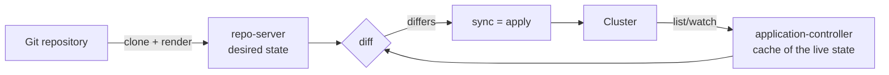

# What is Argo CD

A GitOps CD tool for Kubernetes. It is a group of controllers that keeps doing one thing: comparing the declaration written in Git (desired) with the actual state of the cluster (live) and, when they differ, converging on the Git side.

## The GitOps idea

The quickest way to get it is to contrast it with traditional push-style CD (CI runs kubectl apply).

| | Push style (CI applies) | GitOps (pull style) |
|---|---|---|
| What starts a change | A CI pipeline run | A Git commit |
| Cluster credentials | Must be handed to CI | Stay inside the cluster (or the hub) |
| Manual changes (kubectl edit) | Remain until the next deploy | Are detected and reverted automatically |
| Rollback | A redeploy procedure | git revert |
| "What is running now" | Dig through CI logs | Look at Git |

The core invariant is that **Git is the single source of truth**. By funnelling every change to the cluster through Git, auditing, reproduction and recovery all reduce to Git operations.

## How it works: the reconcile loop



- **desired**: the manifests in Git (kustomize / helm are rendered before comparing)
- **live**: the real resources in the cluster. They are kept cached through watches
- syncPolicy decides what to do with a difference (next section)

## syncPolicy: the set of three you get a feel for in this lab

```yaml
syncPolicy:
  automated:
    prune: true    # resources removed from Git are deleted from the real cluster too
    selfHeal: true # manual changes (kubectl edit/scale) are detected and reverted
  syncOptions:
    - ServerSideApply=true
    - CreateNamespace=true
```

With these three enabled, operations become "**what is declared is what is governed**":

- If a field written in Git is changed -> it is reverted (selfHeal)
- If a resource is removed from Git -> the real thing is removed too (prune)
- In other words, every change, deletion and rollback is funnelled into Git operations (PRs and reverts)

## Architecture (components)

| Component | Kind | Role |
|---|---|---|
| application-controller | StatefulSet | **The core**. Diffing, syncing and health assessment. It holds the cache of the destination clusters, so it is memory-hungry |
| repo-server | Deployment | Clones Git and renders (kustomize/helm) |
| server | Deployment | The web UI and the API (what the CLI connects to) |
| applicationset-controller | Deployment | Mass-produces Applications from ApplicationSets (generation only. It does not sync) |
| redis | Deployment | Cache for render results and the like |
| dex / notifications-controller | Deployment | SSO / notifications (disabled in this lab) |

## Multi-cluster (hub-spoke)

One Argo CD (the hub) can deploy to several clusters (the spokes).

- A destination cluster is registered as a Secret with the label `argocd.argoproj.io/secret-type: cluster`. In this lab, `scripts/04-spokes.sh` fills the dynamic values and the secret into `hub/clusters.yaml` (the template) and applies it
- `destination.name` of an Application refers to this registered name and is resolved through it
- AppProject restricts which Application may go to which cluster x namespace ([03-argocd-crds.md](03-argocd-crds.md))

Note that hub / spoke are general topology terms (the hub and spokes of a wheel). Argo CD's official terminology simply says cluster / destination.

## Scope: can it deploy things other than K8s

The destination of Argo CD is always a K8s cluster, and what a sync actually does is apply K8s resources.
It cannot deploy **directly** to non-K8s resources such as Cloud Run or Lambda.

However, putting an operator in between, one that represents external resources as K8s custom resources, widens what it governs:

```
Argo CD ──sync──▶ CR on the K8s API ──the operator reconciles──▶ the real external resource
```

- Config Connector (GCP. Example: `RunService` CR -> a real Cloud Run service)
- Crossplane (multi-cloud) / ACK (AWS)
- ESO is the same pattern (ExternalSecret CR -> the value in an external store)

To be precise: Argo CD governs *declarations that can be placed on the K8s API*, and no further. Reflecting a declaration in the outside world is the operator's job.

## How it maps to this lab

| Concept | The real thing in the lab |
|---|---|
| Argo CD itself | `hub/argocd/` (the chart rendered with kustomize) |
| Cluster registration Secret | `scripts/04-spokes.sh` fills values into `hub/clusters.yaml` (the template) and applies it |
| Mass production of Applications | `hub/applicationset.yaml` + markers |
| Hand-written Applications | `hub/platform.yaml` (gitea / vault to the hub itself = in-cluster) |
| Boundaries (authorization) | `hub/appproject.yaml` (demo) + `hub/platform.yaml` (platform) |
| Permissions on the destination clusters | `spoke/rbac.yaml` |
