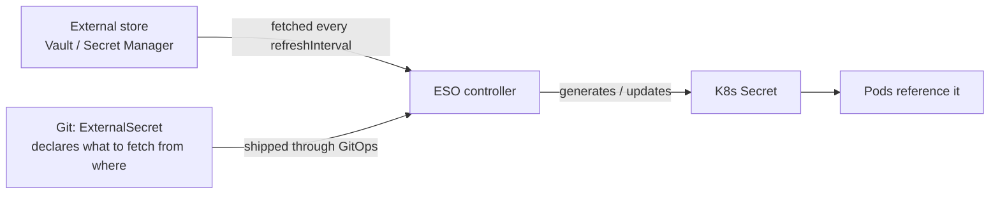

# ESO: what External Secrets Operator is

## The problem: Secrets do not fit GitOps naturally

The principle of GitOps is to write everything in Git, but the value of a Secret is the one thing that cannot go there
(a plaintext commit is out of the question, and read access to the repository would equal read access to the secrets). There are two main families of solutions:

| Approach | Examples | Idea |
|---|---|---|
| Encrypt and keep in Git | Sealed Secrets, SOPS | Commit the value itself as ciphertext |
| **Keep the value outside, keep only a reference in Git** | **ESO** | Make an external secret store the source of truth |

ESO is the latter. It treats a cloud secret management service (GCP Secret Manager / AWS Secrets Manager /
Vault and so on) as the source of truth, and is **an operator that keeps fetching values from there and generating / updating K8s Secrets**.



Only the declaration goes into Git, and the value exists only in the external store. The GitOps principle and secret management coexist.

## There are effectively two CRDs

**SecretStore / ClusterSecretStore**: the definition of "connection and auth" to the external store.

```yaml
# seed-repo/app/secrets/overlay/dev/demo-secrets/secretstore.yaml in this lab
spec:
  provider:
    vault:
      server: http://demo-hub-control-plane:30201
      path: secret
      version: v2
      auth:
        tokenSecretRef: {name: vault-token, key: token}
```

- SecretStore is namespace-scoped, ClusterSecretStore is shared across the cluster
- There is a provider per kind of store (vault / gcpsm / aws / fake and many more)
- Auth is a token in the lab (in production the norm is cloud IAM integration, which makes it secretless)

**ExternalSecret**: the declaration of which key's value to copy into which K8s Secret.

```yaml
# externalsecret.yaml in the same directory
spec:
  refreshInterval: 15s          # checks the external store at this interval and reflects changes
  secretStoreRef: {kind: SecretStore, name: vault}
  target:
    name: demo-app-secret       # name of the K8s Secret that gets generated
    creationPolicy: Owner       # ESO owns the Secret (recreates it if it disappears)
  data:
    - secretKey: message        # key on the Secret side
      remoteRef:
        key: demo-app           # key on the external store side
        property: message
```

## The helm chart and the components it installs

The chart is [external-secrets](https://artifacthub.io/packages/helm/external-secrets-operator/external-secrets)
(repository: `https://charts.external-secrets.io`). In this lab `scripts/06-eso.sh` installs it
on spoke-dev. Like Argo CD itself, one chart brings in the whole set of controllers, and
it is split into three Deployments:

| Component | Role |
|---|---|
| external-secrets (core controller) | The core. Reconciles SecretStore / ExternalSecret, fetches values from the external store and generates / updates K8s Secrets |
| external-secrets-webhook | Admission/conversion webhook. Handles **validation** of ExternalSecret / SecretStore and **conversion** between CRD versions |
| external-secrets-cert-controller | Generates the TLS certificate for the webhook and keeps injecting the CA bundle into the CRDs and the ValidatingWebhookConfiguration (a webhook requires TLS) |

Note that while the chart of Argo CD itself is pinned (10.18.0 in `hub/argocd/kustomization.yaml`),
ESO is deliberately not pinned and installs the latest. In production the norm is to pin ESO too and update it on a plan with Renovate or similar.

The values are all chart defaults (unlike Argo CD, the lab needs no customization).
The defaults worth knowing (uninstall removes the CRDs too, the entry point for IAM integration, the watch scope and so on) are
collected as comments in `spoke/eso-values.yaml`.

## Operational properties

- **Rotation becomes "just swap the value"**: update the value in the external store and the K8s Secret
  follows after refreshInterval. Neither the manifests nor the Pod definitions are touched
  (try it in the lab with `mise rotate ...`)
- **An ExternalSecret is an ordinary manifest**, so Argo CD can ship it.
  This lab ships it as a second marker app (`mise marker-secrets`)
- One known quirk with Argo CD: defaults from the CRD schema are filled in on the live side of an
  ExternalSecret, so Argo CD's diff can wrongly report it as **permanently OutOfSync**.
  The Application annotation `argocd.argoproj.io/compare-options: ServerSideDiff=true`
  (lets a dry-run on kube-apiserver predict the diff) resolves it

## The whole flow in the lab

```bash
# Vault (the external store) + ESO + the auth token are already installed by mise cluster-up (re-run on its own: mise eso-up)
# Vault itself is also managed through GitOps as the hand-written Application `vault` (hub/platform.yaml)
mise marker-secrets  # ship the ExternalSecret through GitOps
kubectl --context kind-demo-dev -n demo-app get secret demo-app-secret \
  -o jsonpath='{.data.message}' | base64 -d
mise rotate v2 # update the source of truth -> the Secret follows 15 seconds later
```

Confirming that the value `s3cr3t...` appears nowhere in Git at this point makes the reason ESO exists sink in.
